<!-- ═══════════════════════════════════════════════════════════════════════ -->
<!--  Mahdi Mortazavi · مهدی مرتضوی — GitHub profile                          -->
<!--                                                                         -->
<!--  PARTS OF THIS FILE ARE GENERATED. Everything between LIVE:X markers    -->
<!--  is rewritten by .github/workflows/live-profile.yml.                    -->
<!--                                                                         -->
<!--  • What the page SAYS (positioning, availability, links, the project    -->
<!--    list, the timeline) lives in .github/scripts/profile.config.mjs.     -->
<!--  • How it LOOKS lives in lib-cards.mjs and lib-art.mjs.                 -->
<!--  • Every card is a self-hosted animated SVG: no third-party service.    -->
<!--  • Two canvases per card: 900 wide for phones, 1600 wide for desktop.   -->
<!--  • Images are not crawled. The headings and paragraphs below are the    -->
<!--    SEO surface, so keep the name in English and Persian as real text.   -->
<!-- ═══════════════════════════════════════════════════════════════════════ -->

<a href="https://mahdi-mortazavi.github.io">
<picture>
  <source media="(max-width: 699px)" srcset="https://raw.githubusercontent.com/Mahdi-mortazavi/Mahdi-mortazavi/main/assets/live/hero.svg" />
  
</picture>
</a>

<!-- LIVE:NAV -->

<!-- /LIVE:NAV -->

# Mahdi Mortazavi · مهدی مرتضوی

**CTO and product engineer. I take a messy problem, reduce it to first principles, and ship the answer as software people actually use.**

I'm **Mahdi Mortazavi** (مهدی مرتضوی), a full-stack developer and product builder from Iran.
I lead engineering and product at **[Senagh](https://senagh.ir)**, an AI-agent assistant for real-estate
agents, and I'm co-founder and CTO of **Zista Health**, an AI-powered remote patient monitoring platform.
On the side I build open-source tools across mobile, desktop, web and the edge, and I finish them:
versioned releases, installers, documentation, two languages.

<!-- LIVE:PROOF -->
**381** stars &nbsp;·&nbsp; **30** forks &nbsp;·&nbsp; **11,270+** downloads &nbsp;·&nbsp; **54** releases shipped &nbsp;·&nbsp; **1,684** contributions in the last year
<!-- /LIVE:PROOF -->

> **Open to** remote roles, contract and freelance product builds, and technical co-founder / CTO work.
> **Timezone** UTC+3:30, with a full working day of overlap with Europe.
> **Fastest reply** on [Telegram](https://t.me/Mahdi_mortazavi1) or by [email](mailto:mahdi.mortazavi.135@gmail.com).

<picture>
  <source media="(max-width: 699px)" srcset="https://raw.githubusercontent.com/Mahdi-mortazavi/Mahdi-mortazavi/main/assets/showreel.svg" />
  
</picture>

## Selected work

Each card is a live product you can install today. Stars, versions and release dates are read from the GitHub API.

<!-- LIVE:PROJECTS -->
<a href="https://github.com/Mahdi-mortazavi/relay"><picture>
  <source media="(max-width: 699px)" srcset="https://raw.githubusercontent.com/Mahdi-mortazavi/Mahdi-mortazavi/main/assets/live/p-relay.svg" />
  
</picture></a>

<b><a href="https://github.com/Mahdi-mortazavi/relay">relay</a></b> &nbsp;·&nbsp; Kotlin &nbsp;·&nbsp; ★ 241 &nbsp;·&nbsp; <a href="https://github.com/Mahdi-mortazavi/relay/releases/latest"><code>v2.12.0</code></a> &nbsp;·&nbsp; 10,305 downloads &nbsp;·&nbsp; <a href="https://mahdi-mortazavi.github.io/p/relay/">Try it ↗</a>

<a href="https://github.com/Mahdi-mortazavi/angaros"><picture>
  <source media="(max-width: 699px)" srcset="https://raw.githubusercontent.com/Mahdi-mortazavi/Mahdi-mortazavi/main/assets/live/p-angaros.svg" />
  
</picture></a>

<b><a href="https://github.com/Mahdi-mortazavi/angaros">Angaros</a></b> &nbsp;·&nbsp; Python &nbsp;·&nbsp; <a href="https://github.com/Mahdi-mortazavi/angaros/releases/latest"><code>v3.1.0</code></a> &nbsp;·&nbsp; <a href="https://mahdi-mortazavi.github.io/angaros/">Try it ↗</a>

<a href="https://github.com/Mahdi-mortazavi/flow"><picture>
  <source media="(max-width: 699px)" srcset="https://raw.githubusercontent.com/Mahdi-mortazavi/Mahdi-mortazavi/main/assets/live/p-flow.svg" />
  
</picture></a>

<b><a href="https://github.com/Mahdi-mortazavi/flow">Flow</a></b> &nbsp;·&nbsp; Dart &nbsp;·&nbsp; ★ 76 &nbsp;·&nbsp; <a href="https://github.com/Mahdi-mortazavi/flow/releases/latest"><code>v0.6.1</code></a> &nbsp;·&nbsp; 788 downloads &nbsp;·&nbsp; <a href="https://mahdi-mortazavi.github.io/p/flow/">Try it ↗</a>

<a href="https://github.com/Mahdi-mortazavi/overrun"><picture>
  <source media="(max-width: 699px)" srcset="https://raw.githubusercontent.com/Mahdi-mortazavi/Mahdi-mortazavi/main/assets/live/p-overrun.svg" />
  
</picture></a>

<b><a href="https://github.com/Mahdi-mortazavi/overrun">Overrun</a></b> &nbsp;·&nbsp; JavaScript &nbsp;·&nbsp; <a href="https://overrun.mahdi-mortazavi-135.workers.dev/landing">Try it ↗</a>

<b>3 more shipped projects</b> &nbsp;·&nbsp; Sooda · purify · Nava

 

<a href="https://github.com/Mahdi-mortazavi/sooda"><picture>
  <source media="(max-width: 699px)" srcset="https://raw.githubusercontent.com/Mahdi-mortazavi/Mahdi-mortazavi/main/assets/live/p-sooda.svg" />
  
</picture></a>

<b><a href="https://github.com/Mahdi-mortazavi/sooda">Sooda</a></b> &nbsp;·&nbsp; TypeScript &nbsp;·&nbsp; ★ 30 &nbsp;·&nbsp; <a href="https://github.com/Mahdi-mortazavi/sooda/releases/latest"><code>v1.5.0</code></a> &nbsp;·&nbsp; <a href="https://mahdi-mortazavi.github.io/sooda/">Try it ↗</a>

<a href="https://github.com/Mahdi-mortazavi/purify"><picture>
  <source media="(max-width: 699px)" srcset="https://raw.githubusercontent.com/Mahdi-mortazavi/Mahdi-mortazavi/main/assets/live/p-purify.svg" />
  
</picture></a>

<b><a href="https://github.com/Mahdi-mortazavi/purify">purify</a></b> &nbsp;·&nbsp; Rust &nbsp;·&nbsp; <a href="https://github.com/Mahdi-mortazavi/purify/releases/latest"><code>v0.1.4</code></a> &nbsp;·&nbsp; <a href="https://mahdi-mortazavi.github.io/p/purify/">Try it ↗</a>

<a href="https://github.com/Mahdi-mortazavi/app"><picture>
  <source media="(max-width: 699px)" srcset="https://raw.githubusercontent.com/Mahdi-mortazavi/Mahdi-mortazavi/main/assets/live/p-app.svg" />
  
</picture></a>

<b><a href="https://github.com/Mahdi-mortazavi/app">Nava</a></b> &nbsp;·&nbsp; Dart &nbsp;·&nbsp; ★ 26 &nbsp;·&nbsp; <a href="https://github.com/Mahdi-mortazavi/app/releases/latest"><code>v3.1.0</code></a> &nbsp;·&nbsp; 111 downloads &nbsp;·&nbsp; <a href="https://mahdi-mortazavi.github.io/p/nava/">Try it ↗</a>

<!-- /LIVE:PROJECTS -->

**What these show.**
**[relay](https://github.com/Mahdi-mortazavi/relay)** is systems and networking work: Android to Windows reverse tethering over **WireGuard**, in Kotlin, C# and Go, with no root, no server and no account.
**[Angaros](https://github.com/Mahdi-mortazavi/angaros)** is AI infrastructure: an end-to-end encrypted **MCP server** that gives AI agents safe access to a phone's SMS, OTP codes, contacts and call log.
**[Flow](https://github.com/Mahdi-mortazavi/flow)** and **[Nava](https://github.com/Mahdi-mortazavi/app)** are product and interface design in **Flutter**.
**[Overrun](https://github.com/Mahdi-mortazavi/overrun)** is realtime multiplayer netcode on **Cloudflare Workers** and Durable Objects.
**[Sooda](https://github.com/Mahdi-mortazavi/sooda)** is an offline-first **TypeScript PWA**, and **[purify](https://github.com/Mahdi-mortazavi/purify)** is a native Windows utility in **Rust** and **Tauri**.

**How these were built:** the [case studies](https://github.com/Mahdi-mortazavi/Mahdi-mortazavi/tree/main/work#readme) walk through the problem, the first principle and the decisions behind relay, Angaros and Overrun.

## Experience

<picture>
  <source media="(max-width: 699px)" srcset="https://raw.githubusercontent.com/Mahdi-mortazavi/Mahdi-mortazavi/main/assets/live/journey.svg" />
  
</picture>

- **[Senagh](https://senagh.ir) — CTO & Head of Product** · 2023 to now 
  An AI-agent assistant for real-estate agents. I own the architecture, the agent design and the product direction, and I lead the build from backend to client.
- **Zista Health — Co-founder & CTO** 
  AI-powered remote patient monitoring, from the wearable to the apps. I lead engineering and product.
- **[Startup Legend](https://t.me/Startup_legend) — Founder** 
  A community for people building startups and products.
- **Open source — author and maintainer** 
  Seven shipped projects in six languages, all free, all bilingual (English / فارسی).

### How I work

1. **First principles.** I break the problem down to what is actually true instead of copying the usual solution. That is where the 10x answer tends to hide.
2. **Design the solution.** A solution is designed, not just coded: clear, fast, and obvious to the person using it.
3. **Ship it.** Nothing counts until someone can install it. I take work all the way to a release.

## Stack

<picture>
  <source media="(max-width: 699px)" srcset="https://raw.githubusercontent.com/Mahdi-mortazavi/Mahdi-mortazavi/main/assets/live/stack.svg" />
  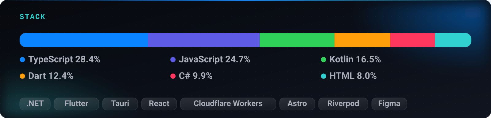
</picture>

Measured from the bytes in my public repositories, not typed by hand.

| Area | What I use |
| :-- | :-- |
| **AI & agents** | LLM agents, MCP servers, tool design, Python, TypeScript |
| **Mobile** | Flutter & Dart, Kotlin, Jetpack Compose |
| **Desktop** | Rust, Tauri, C# / .NET, WinUI 3 |
| **Web & edge** | TypeScript, React, Astro, Node.js, NestJS, Cloudflare Workers, Supabase |
| **Product** | Problem framing, interface design, bilingual RTL products, release engineering |

## Activity

<picture>
  <source media="(max-width: 699px)" srcset="https://raw.githubusercontent.com/Mahdi-mortazavi/Mahdi-mortazavi/main/assets/live/growth.svg" />
  
</picture>

<picture>
  <source media="(max-width: 699px)" srcset="https://raw.githubusercontent.com/Mahdi-mortazavi/Mahdi-mortazavi/main/assets/live/heat.svg" />
  
</picture>

<picture>
  <source media="(max-width: 699px)" srcset="https://raw.githubusercontent.com/Mahdi-mortazavi/Mahdi-mortazavi/main/assets/live/velocity.svg" />
  
</picture>

**Latest releases**

<!-- LIVE:SHIPPING -->
- **[relay v2.12.0](https://github.com/Mahdi-mortazavi/relay/releases/tag/v2.12.0)** · released 10 Nov 2026
- **[Angaros v3.1.0](https://github.com/Mahdi-mortazavi/angaros/releases/tag/v3.1.0)** · released 5 Nov 2026
- **[Angaros v3.0.3](https://github.com/Mahdi-mortazavi/angaros/releases/tag/v3.0.3)** · released 2 Nov 2026
- **[relay v2.11.1](https://github.com/Mahdi-mortazavi/relay/releases/tag/v2.11.1)** · released 21 Oct 2026
- **[relay v2.11.0](https://github.com/Mahdi-mortazavi/relay/releases/tag/v2.11.0)** · released 21 Oct 2026
<!-- /LIVE:SHIPPING -->

## The wall

<picture>
  <source media="(max-width: 699px)" srcset="https://raw.githubusercontent.com/Mahdi-mortazavi/Mahdi-mortazavi/main/assets/live/wall.svg" />
  
</picture>

These are the people following my work. Follow, and your avatar takes the next seat when the page rebuilds, within six hours.

## Work with me

I'm most useful where the problem is still messy and the shape of the answer is not decided yet.

- **Hiring a remote engineer?** I work as a senior full-stack or product engineer, or as a technical lead. [Evaluate me in ten minutes →](https://github.com/Mahdi-mortazavi/Mahdi-mortazavi/tree/main/hire#readme)
- **Building a product?** I take contract and freelance builds: AI agents, mobile apps, desktop tools, web apps and the design that goes with them. [How an engagement runs →](https://github.com/Mahdi-mortazavi/Mahdi-mortazavi/tree/main/build#readme)
- **Need a technical co-founder?** I'm already CTO of two products, so I know what the job takes. If the problem is real, let's talk.

The first two buttons open a short public form in this repository. Questions I answer are listed here automatically. For anything confidential, use email or Telegram.

<!-- LIVE:AMA -->

<!-- /LIVE:AMA -->

<b>Questions people ask before we start</b>

 

**What kind of work do you take?**
Full-stack product work: AI agents and MCP tooling, mobile (Flutter, Kotlin), desktop (Rust, Tauri, .NET), web and edge (TypeScript, React, Cloudflare Workers), plus the interface design that goes with it.

**Can I see how you actually work?**
Yes. Every project above is open source, with its commit history, issues and releases in public. Read the code before we talk.

**Do you work with teams outside Iran?**
Yes, remotely. I'm at UTC+3:30, which overlaps a full working day with Europe.

**Are your apps free?**
All of them are free and open source. Each repository carries its own licence file.

## فارسی

<b>سلام، من مهدی مرتضوی هستم</b>؛ مدیر فنی (CTO)، توسعه‌دهنده‌ی فول‌استک و سازنده‌ی محصول از ایران.
روش کارم ساده است: <b>تفکر بر پایه‌ی اصول اولیه ← طراحی راه‌حل ← ساخت محصول واقعی</b>.
مدیر فنی و مدیر محصول <a href="https://senagh.ir">ثناق</a> (دستیار هوش مصنوعی مشاوران املاک) و
هم‌بنیان‌گذار و مدیر فنی <b>Zista Health</b> (پایش از راه دور بیماران با هوش مصنوعی) هستم.

پروژه‌های متن‌باز من رایگان و دوزبانه‌اند:
<b><a href="https://github.com/Mahdi-mortazavi/relay">ریلی</a></b> برای اشتراک اینترنت گوشی اندروید با کامپیوتر ویندوز از راه تونل وایرگارد، بدون روت و بدون سرور؛
<b><a href="https://github.com/Mahdi-mortazavi/angaros">Angaros</a></b>، پل امن میان گوشی و ایجنت‌های هوش مصنوعی برای پیامک، کد تأیید و مخاطبان؛
<b><a href="https://github.com/Mahdi-mortazavi/flow">تک‌نقطه</a></b>، اپلیکیشن آفلاین تمرکز و ساخت عادت؛
<b><a href="https://github.com/Mahdi-mortazavi/sooda">سودا</a></b>، ماشین‌حساب سود، قیمت فروش و تخفیف؛
<b><a href="https://github.com/Mahdi-mortazavi/purify">پیوریفای</a></b> برای پاک‌سازی دیسک ویندوز؛ و
<b><a href="https://github.com/Mahdi-mortazavi/app">نوا</a></b>، اپ بهره‌وری مینیمال.

برای همکاری، پروژه‌ی فریلنس، استخدام دورکار یا هم‌بنیان‌گذاری در دسترسم.
سریع‌ترین راه ارتباط <a href="https://t.me/Mahdi_mortazavi1">تلگرام</a> یا
<a href="mailto:mahdi.mortazavi.135@gmail.com">ایمیل</a> است.
جامعه‌ی <a href="https://t.me/Startup_legend">استارتاپ لجند</a> را هم برای سازندگان محصول و استارتاپ راه انداخته‌ام.

 

<!-- LIVE:UPDATED -->
This page rebuilds itself every 6 hours from the GitHub API · last run <b>14 Nov 2026, 09:37</b> Tehran time
<!-- /LIVE:UPDATED -->

<b>Mahdi Mortazavi</b> &nbsp;·&nbsp; <b>مهدی مرتضوی</b> &nbsp;·&nbsp; CTO &nbsp;·&nbsp; Product Engineer &nbsp;·&nbsp; Full-Stack Developer &nbsp;·&nbsp; Iran

<picture>
  <source media="(max-width: 699px)" srcset="https://raw.githubusercontent.com/Mahdi-mortazavi/Mahdi-mortazavi/main/assets/live/footer.svg" />
  
</picture>
