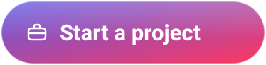

<!-- LIVE:NAV -->

<!-- /LIVE:NAV -->

# Build a product with Mahdi Mortazavi

You have a problem worth solving and need someone who can take it from a rough idea to software people install. That is the work I like most.

## What I build

- **AI agents and assistants** that do a real job inside a business, like the one I lead at [Senagh](https://senagh.ir) for real-estate agents.
- **Mobile apps** in Flutter and Kotlin, including Telegram Mini Apps and bilingual, right-to-left products.
- **Desktop tools** in Rust, Tauri and .NET.
- **Web apps and edge backends** in TypeScript, React and Cloudflare Workers.
- **The design that goes with them.** I design the interface I build, so nothing is lost between a mock-up and the product.

## How an engagement runs

1. **Frame.** We reduce the idea to the problem, the user and the one thing the first version must do. You get this in writing before any code.
2. **Prototype.** I build the riskiest part first, so we learn early whether the idea holds.
3. **Ship.** A real release: installable, documented, with the limits written down.
4. **Hand over or keep going.** The code is yours and readable. I can stay on, or leave it in a state another engineer can pick up.

## What you can check before we talk

Every project on my [overview](https://github.com/Mahdi-mortazavi) is open source. The [case studies](https://github.com/Mahdi-mortazavi/Mahdi-mortazavi/tree/main/work#readme) show how I make decisions, and the release history shows that I finish.

<picture>
  <source media="(max-width: 699px)" srcset="https://raw.githubusercontent.com/Mahdi-mortazavi/Mahdi-mortazavi/main/assets/live/velocity.svg" />
  
</picture>

## Start

The first button opens a short public form. For anything confidential, use email or Telegram.
