<!-- LIVE:NAV -->

<!-- /LIVE:NAV -->

<h1 dir="rtl" align="right">مهدی مرتضوی · Mahdi Mortazavi</h1>

<b>مدیر فنی (CTO) و مهندس محصول.</b> مسئله‌ی آشفته را تا اصول اولیه‌اش ساده می‌کنم و جوابش را به نرم‌افزاری تبدیل می‌کنم که مردم واقعاً نصب و استفاده می‌کنند.

من <b>مهدی مرتضوی</b> هستم؛ توسعه‌دهنده‌ی فول‌استک و سازنده‌ی محصول از ایران.
مدیر فنی و مدیر محصول <a href="https://senagh.ir">ثناق</a> هستم، دستیار هوش مصنوعی برای مشاوران املاک؛
و هم‌بنیان‌گذار و مدیر فنی <b>Zista Health</b>، سکوی پایش از راه دور بیماران با هوش مصنوعی.
در کنار این‌ها ابزارهای متن‌باز می‌سازم و تا انتشار نسخه‌ی نهایی پیش می‌برم.

<picture>
  <source media="(max-width: 699px)" srcset="https://raw.githubusercontent.com/Mahdi-mortazavi/Mahdi-mortazavi/main/assets/live/hero.svg" />
  
</picture>

<h2 dir="rtl" align="right">روش کار من</h2>

<b>۱. تفکر بر پایه‌ی اصول اولیه.</b> مسئله را تا چیزی که واقعاً درست است تجزیه می‌کنم، نه اینکه راه‌حل رایج را تکرار کنم. 
<b>۲. طراحی راه‌حل.</b> راه‌حل باید طراحی شود، نه فقط کدنویسی؛ روشن، سریع و بدیهی برای کاربر. 
<b>۳. ساخت محصول واقعی.</b> تا وقتی کسی نتواند نصبش کند، به حساب نمی‌آید.

<h2 dir="rtl" align="right">پروژه‌های متن‌باز</h2>

همه رایگان، متن‌باز و دوزبانه (فارسی / English) هستند.

<b><a href="https://github.com/Mahdi-mortazavi/relay">ریلی (relay)</a></b> — اشتراک اینترنت گوشی اندروید با کامپیوتر ویندوز از راه تونل رمزنگاری‌شده‌ی وایرگارد؛ بدون روت، بدون سرور و بدون حساب کاربری. 
<b><a href="https://github.com/Mahdi-mortazavi/angaros">Angaros</a></b> — پل امن میان گوشی و ایجنت‌های هوش مصنوعی: پیامک، کد تأیید، مخاطبان و تماس‌ها با رمزنگاری سرتاسری. 
<b><a href="https://github.com/Mahdi-mortazavi/flow">تک‌نقطه (Flow)</a></b> — اپلیکیشن آفلاین تمرکز و ساخت عادت، بر پایه‌ی علم رفتار. 
<b><a href="https://github.com/Mahdi-mortazavi/overrun">Overrun</a></b> — بازی شوتر چندنفره‌ی تحت مرورگر که آفلاین هم اجرا می‌شود. 
<b><a href="https://github.com/Mahdi-mortazavi/sooda">سودا</a></b> — ماشین‌حساب سود، قیمت فروش و تخفیف برای کسب‌وکارهای کوچک. 
<b><a href="https://github.com/Mahdi-mortazavi/purify">پیوریفای (purify)</a></b> — پاک‌سازی سریع و برگشت‌پذیر دیسک ویندوز. 
<b><a href="https://github.com/Mahdi-mortazavi/app">نوا (Nava)</a></b> — اپ بهره‌وری مینیمال.

<picture>
  <source media="(max-width: 699px)" srcset="https://raw.githubusercontent.com/Mahdi-mortazavi/Mahdi-mortazavi/main/assets/live/velocity.svg" />
  
</picture>

<h2 dir="rtl" align="right">همکاری</h2>

برای <b>استخدام دورکار</b>، <b>پروژه‌ی فریلنس</b> و <b>هم‌بنیان‌گذاری فنی</b> در دسترسم.
بیشترین فایده را جایی دارم که مسئله هنوز آشفته است و شکل جواب مشخص نیست.
سریع‌ترین راه ارتباط تلگرام یا ایمیل است.
جامعه‌ی <a href="https://t.me/Startup_legend">استارتاپ لجند</a> را هم برای سازندگان محصول و استارتاپ راه انداخته‌ام.

