<!-- LIVE:NAV -->

<!-- /LIVE:NAV -->

# Hire Mahdi Mortazavi

**CTO and product engineer, available for remote work.** This page is built to save you time: how to evaluate me quickly, where the evidence is, and how I work.

## Evaluate me in ten minutes

1. **Two minutes: how I think.** Read one [case study](https://github.com/Mahdi-mortazavi/Mahdi-mortazavi/tree/main/work#readme). Each one goes problem, first principle, decisions, and what is still not done.
2. **Five minutes: how I build.** Open a document I wrote for other engineers: the [Angaros wire protocol](https://github.com/Mahdi-mortazavi/angaros/blob/main/shared/PROTOCOL.md), its [threat model](https://github.com/Mahdi-mortazavi/angaros/blob/main/SECURITY.md), or [Overrun's netcode notes](https://github.com/Mahdi-mortazavi/overrun#netcode-honestly).
3. **Three minutes: how I ship.** Look at the release history of [relay](https://github.com/Mahdi-mortazavi/relay/releases). Versioned releases, installers and changelogs, on a steady rhythm.

<picture>
  <source media="(max-width: 699px)" srcset="https://raw.githubusercontent.com/Mahdi-mortazavi/Mahdi-mortazavi/main/assets/live/velocity.svg" />
  
</picture>

## Where the evidence is

| If you need | Look at | What it shows |
| :-- | :-- | :-- |
| **AI agents and tooling** | [Angaros](https://github.com/Mahdi-mortazavi/angaros) | An MCP server with 22 typed tools, prompt-injection defences and an audit log |
| **Systems and networking** | [relay](https://github.com/Mahdi-mortazavi/relay) | WireGuard tunnelling across Android and Windows in Kotlin, C# and Go |
| **Realtime backend** | [Overrun](https://github.com/Mahdi-mortazavi/overrun) | Authoritative server on Cloudflare Durable Objects, prediction and reconciliation |
| **Mobile** | [Flow](https://github.com/Mahdi-mortazavi/flow), [Nava](https://github.com/Mahdi-mortazavi/app) | Flutter apps with offline-first data and careful motion |
| **Desktop** | [purify](https://github.com/Mahdi-mortazavi/purify), [relay](https://github.com/Mahdi-mortazavi/relay) | Rust and Tauri, .NET 8 and WinUI 3 |
| **Web** | [Sooda](https://github.com/Mahdi-mortazavi/sooda) | An offline-first TypeScript PWA with no backend |
| **Technical leadership** | [Senagh](https://senagh.ir) | CTO and Head of Product since 2023: architecture, agent design, product direction |

## How I work

- **Remote and async-friendly.** I'm at UTC+3:30, with a full working day of overlap with Europe.
- **Written first.** I write the protocol, the threat model and the limits down, as the repositories above show.
- **Honest status.** My READMEs have a "not done yet" section. So do my updates.
- **Open to** full-time remote roles, contracts, and technical co-founder or CTO positions.
- **Languages:** Persian (native) and English.

## Next step

Send a short note about the role and the problem. If you prefer a form, [start here](https://github.com/Mahdi-mortazavi/Mahdi-mortazavi/issues/new?template=project.yml).

