<!-- LIVE:NAV -->

<!-- /LIVE:NAV -->

# Ship log · Mahdi Mortazavi

Every release I have published, newest first. This page is written by a script from the GitHub releases API, so it cannot claim more than I shipped.

<picture>
  <source media="(max-width: 699px)" srcset="https://raw.githubusercontent.com/Mahdi-mortazavi/Mahdi-mortazavi/main/assets/live/velocity.svg" />
  
</picture>

### November 2026

- **[relay v2.12.0](https://github.com/Mahdi-mortazavi/relay/releases/tag/v2.12.0)** · 10 Nov 2026
- **[Angaros v3.1.0](https://github.com/Mahdi-mortazavi/angaros/releases/tag/v3.1.0)** · 5 Nov 2026
- **[Angaros v3.0.3](https://github.com/Mahdi-mortazavi/angaros/releases/tag/v3.0.3)** · 2 Nov 2026

### October 2026

- **[relay v2.11.1](https://github.com/Mahdi-mortazavi/relay/releases/tag/v2.11.1)** · 21 Oct 2026
- **[relay v2.11.0](https://github.com/Mahdi-mortazavi/relay/releases/tag/v2.11.0)** · 21 Oct 2026
- **[relay v2.10.0](https://github.com/Mahdi-mortazavi/relay/releases/tag/v2.10.0)** · 21 Oct 2026

### September 2026

- **[relay v2.9.0](https://github.com/Mahdi-mortazavi/relay/releases/tag/v2.9.0)** · 17 Sept 2026
- **[relay v2.8.9](https://github.com/Mahdi-mortazavi/relay/releases/tag/v2.8.9)** · 17 Sept 2026
- **[relay v2.8.8](https://github.com/Mahdi-mortazavi/relay/releases/tag/v2.8.8)** · 16 Sept 2026
- **[relay v2.8.7](https://github.com/Mahdi-mortazavi/relay/releases/tag/v2.8.7)** · 16 Sept 2026
- **[relay v2.8.6](https://github.com/Mahdi-mortazavi/relay/releases/tag/v2.8.6)** · 16 Sept 2026
- **[relay v2.8.5](https://github.com/Mahdi-mortazavi/relay/releases/tag/v2.8.5)** · 16 Sept 2026
- **[Sooda v1.5.0](https://github.com/Mahdi-mortazavi/sooda/releases/tag/v1.5.0)** · 16 Sept 2026
- **[Sooda v1.4.1](https://github.com/Mahdi-mortazavi/sooda/releases/tag/v1.4.1)** · 15 Sept 2026
- **[Sooda v1.4.0](https://github.com/Mahdi-mortazavi/sooda/releases/tag/v1.4.0)** · 15 Sept 2026
- **[Sooda v1.3.0](https://github.com/Mahdi-mortazavi/sooda/releases/tag/v1.3.0)** · 15 Sept 2026
- **[relay v2.8.4](https://github.com/Mahdi-mortazavi/relay/releases/tag/v2.8.4)** · 12 Sept 2026
- **[relay v2.8.3](https://github.com/Mahdi-mortazavi/relay/releases/tag/v2.8.3)** · 12 Sept 2026
- **[relay v2.8.2](https://github.com/Mahdi-mortazavi/relay/releases/tag/v2.8.2)** · 12 Sept 2026
- **[relay v2.8.1](https://github.com/Mahdi-mortazavi/relay/releases/tag/v2.8.1)** · 10 Sept 2026
- **[relay v2.8.0](https://github.com/Mahdi-mortazavi/relay/releases/tag/v2.8.0)** · 7 Sept 2026

### August 2026

- **[relay v2.7.1](https://github.com/Mahdi-mortazavi/relay/releases/tag/v2.7.1)** · 27 Aug 2026
- **[purify v0.1.4](https://github.com/Mahdi-mortazavi/purify/releases/tag/v0.1.4)** · 27 Aug 2026
- **[relay v2.7.0](https://github.com/Mahdi-mortazavi/relay/releases/tag/v2.7.0)** · 25 Aug 2026
- **[relay v2.6.1](https://github.com/Mahdi-mortazavi/relay/releases/tag/v2.6.1)** · 25 Aug 2026
- **[relay v2.6.0](https://github.com/Mahdi-mortazavi/relay/releases/tag/v2.6.0)** · 24 Aug 2026
- **[relay v2.5.0](https://github.com/Mahdi-mortazavi/relay/releases/tag/v2.5.0)** · 24 Aug 2026
- **[Flow v0.6.1](https://github.com/Mahdi-mortazavi/flow/releases/tag/v0.6.1)** · 20 Aug 2026
- **[Overrun v1.0.4](https://github.com/Mahdi-mortazavi/overrun/releases/tag/v1.0.4)** · 21 Aug 2026
- **[Overrun v1.0.3](https://github.com/Mahdi-mortazavi/overrun/releases/tag/v1.0.3)** · 21 Aug 2026
- **[Flow v0.6.0](https://github.com/Mahdi-mortazavi/flow/releases/tag/v0.6.0)** · 16 Aug 2026
- **[Overrun v1.0.2](https://github.com/Mahdi-mortazavi/overrun/releases/tag/v1.0.2)** · 1 Aug 2026
- **[Overrun v1.0.0](https://github.com/Mahdi-mortazavi/overrun/releases/tag/v1.0.0)** · 1 Aug 2026
- **[Overrun v1.0.1](https://github.com/Mahdi-mortazavi/overrun/releases/tag/v1.0.1)** · 1 Aug 2026

### July 2026

- **[Nava v3.1.0](https://github.com/Mahdi-mortazavi/app/releases/tag/v3.1.0)** · 22 Jul 2026
- **[Nava v3.0.0](https://github.com/Mahdi-mortazavi/app/releases/tag/v3.0.0)** · 20 Jul 2026
- **[Flow v0.5.2](https://github.com/Mahdi-mortazavi/flow/releases/tag/v0.5.2)** · 20 Jul 2026
- **[Sooda v1.2.0](https://github.com/Mahdi-mortazavi/sooda/releases/tag/v1.2.0)** · 14 Jul 2026
- **[Sooda v1.1.0](https://github.com/Mahdi-mortazavi/sooda/releases/tag/v1.1.0)** · 14 Jul 2026
- **[Sooda v1.0.0](https://github.com/Mahdi-mortazavi/sooda/releases/tag/v1.0.0)** · 14 Jul 2026

Showing the latest 40 releases. Each project keeps its full history on its own releases page.
