<!-- LIVE:NAV -->

<!-- /LIVE:NAV -->

# Radar · Mahdi Mortazavi

What I am paying attention to, rebuilt every six hours: what I starred, where I contributed, what is rising in the fields I work in, and what Hacker News is discussing about them.

<picture>
  <source media="(max-width: 699px)" srcset="https://raw.githubusercontent.com/Mahdi-mortazavi/Mahdi-mortazavi/main/assets/live/radar.svg" />
  
</picture>

Topics and keywords are set in <code>.github/scripts/profile.config.mjs</code>. The links are picked by a script, not endorsed one by one.
