<!-- LIVE:NAV -->

<!-- /LIVE:NAV -->

# Case studies · Mahdi Mortazavi

Three projects, each told the way I actually work: **the problem, the first principle, the decisions, and what is still not done.**
Everything here is open source, so every claim links to code you can read.

## relay — share a phone's internet at the network layer

<picture>
  <source media="(max-width: 699px)" srcset="https://raw.githubusercontent.com/Mahdi-mortazavi/Mahdi-mortazavi/main/assets/live/d-relay.svg" />
  
</picture>

**The problem.** A PC needs internet and the phone has it: mobile data, Wi-Fi, or a VPN running on the phone. Sharing that connection so that *every* app on the PC works, including games, calls and installers, is harder than it sounds.

**The first principle.** If every app has to work, the sharing has to happen at the network layer, not app by app. So relay carries the whole system, TCP and UDP, through **one encrypted WireGuard tunnel** between the two devices.

**Decisions that follow from it.**

- **No server and no account.** Pairing creates fresh keys, the phone asks before any computer gets in, and the keys are destroyed when sharing stops. Nothing leaves the two devices.
- **"Connected" has to be true.** The status only says connected after a real handshake, and the PC shows live speed, totals and latency.
- **It should survive real networks.** The tunnel follows the phone to a new address and rides out packet loss and a switch from Wi-Fi to LTE. DNS and IPv6 cannot leak around it, and an optional kill switch blocks traffic if the phone stops answering.
- **One contract, two apps.** A shared contract in [`shared/`](https://github.com/Mahdi-mortazavi/relay/tree/main/shared) is what both the Android and the Windows app are tested against.

**Stack.** Kotlin and Jetpack Compose on Android · .NET 8 and WinUI 3 on Windows · Go (wireguard-go and gVisor) for the tunnel.

**Still not done.** One PC per session, IPv4 only inside the tunnel, and the Windows installer is not signed yet. What real hardware has not proved is listed in [`docs/testing.md`](https://github.com/Mahdi-mortazavi/relay/blob/main/docs/testing.md).

**[Read the code →](https://github.com/Mahdi-mortazavi/relay)**

---

## Angaros — give AI agents a phone without giving anyone the messages

<picture>
  <source media="(max-width: 699px)" srcset="https://raw.githubusercontent.com/Mahdi-mortazavi/Mahdi-mortazavi/main/assets/live/d-angaros.svg" />
  
</picture>

**The problem.** AI agents can read email, calendars and files. The one device that holds one-time codes, bank alerts and real conversations is out of reach, or reachable only through an SMS gateway in somebody else's cloud.

**The first principle.** The middle should know nothing. If the relay cannot read a message, it does not matter who runs it or whether it is breached.

**Decisions that follow from it.**

- **The relay is a mailbox of ciphertext.** Phone and computer share a key that travels by QR code and never touches the relay. Every message is sealed with AES-256-GCM, with associated data that stops a blob being replayed in the other direction or to another device.
- **No inbound connections.** Both ends poll out over HTTPS, so it works behind NAT and mobile networks with nothing to open.
- **SMS text is untrusted input.** Anyone can text you, so a message is a possible prompt injection. Results are marked as untrusted content and rules never paste message text into shell commands or prompts.
- **Sending is accountable.** Every SMS an agent sends goes into a hash-chained audit log on both devices, with dry runs and idempotency keys.
- **Agents get real tools.** 22 typed MCP tools, plus a CLI, a Python SDK and a local REST API.

**Stack.** Kotlin and Material 3 on Android · Python, SQLite and full-text search on the computer · a Cloudflare Worker and D1 as the relay.

**Still not done.** Verified on one phone so far. The key is not hardware-backed and the local database is plaintext on disk. The full threat model is in [`SECURITY.md`](https://github.com/Mahdi-mortazavi/angaros/blob/main/SECURITY.md) and the wire protocol in [`shared/PROTOCOL.md`](https://github.com/Mahdi-mortazavi/angaros/blob/main/shared/PROTOCOL.md).

**[Read the code →](https://github.com/Mahdi-mortazavi/angaros)**

---

## Overrun — multiplayer netcode where client and server run the same file

<picture>
  <source media="(max-width: 699px)" srcset="https://raw.githubusercontent.com/Mahdi-mortazavi/Mahdi-mortazavi/main/assets/live/d-overrun.svg" />
  
</picture>

**The problem.** A browser arena shooter for eight players has to feel instant on your own screen and still agree with everyone else's.

**The first principle.** Prediction that uses different code from the authority is prediction that will drift. So there is one simulation, with no DOM, no renderer and no network in it. The browser steps it at 60 Hz, and a Durable Object steps the same file at 20 Hz and is the only authority.

**Decisions that follow from it.**

- **Client-side prediction with input replay.** Inputs carry a sequence number. The server echoes the last one it processed, and the client rewinds to the server's position and replays the rest. Small corrections are eased in so nothing snaps.
- **Entity interpolation.** Everyone else is drawn 100 ms in the past, between two snapshots, because slightly late looks correct and newest-known looks jittery.
- **A quantised binary wire.** Positions are 16-bit fixed point and angles are a single byte, not JSON.
- **No asset files.** Every mesh, texture, animation and sound is generated in code at runtime.
- **Quality follows measurement.** The renderer steps quality up or down on the 90th-percentile frame time, not the mean.

**Stack.** Plain ES modules · three.js and Web Audio · Cloudflare Workers with one Durable Object per match · PWA and Android APK.

**[Read the code →](https://github.com/Mahdi-mortazavi/overrun)** &nbsp;·&nbsp; **[Netcode, in detail →](https://github.com/Mahdi-mortazavi/overrun#netcode-honestly)**

---

### Want this kind of thinking on your problem?

